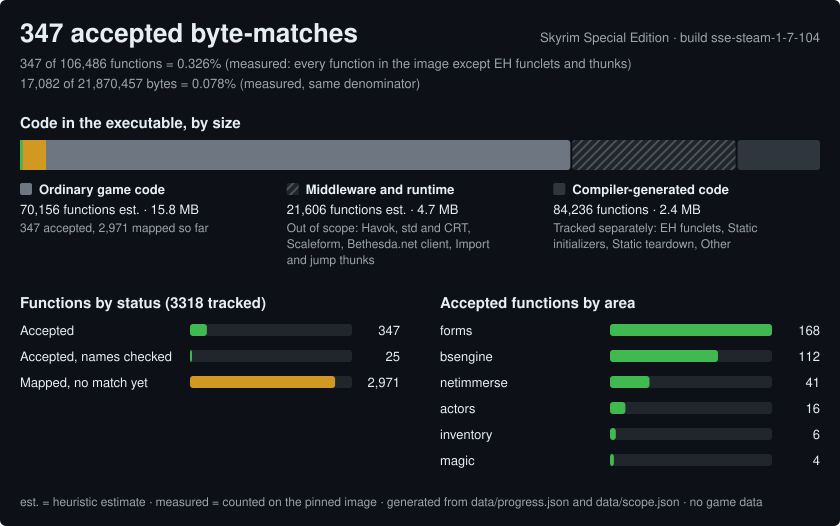
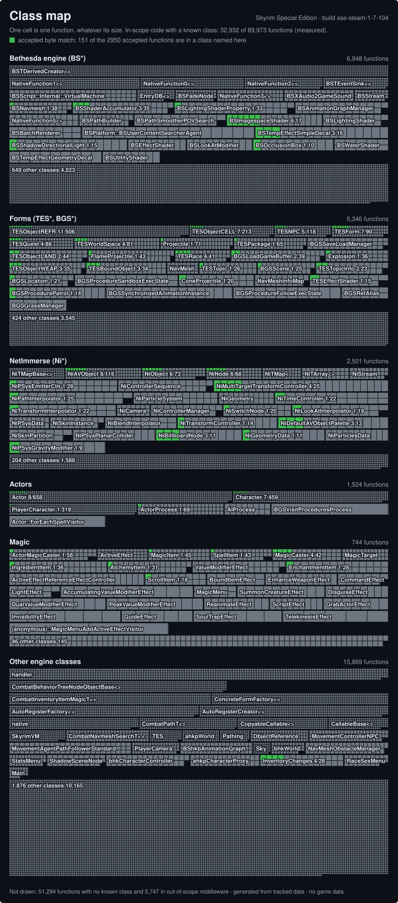
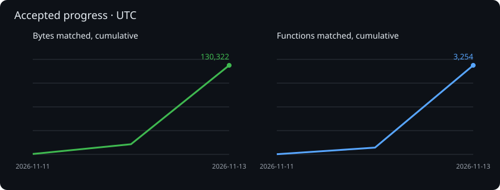
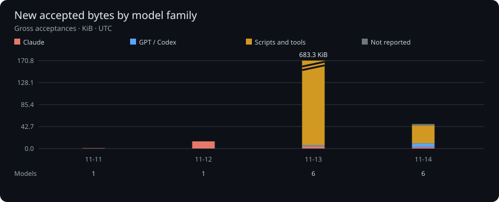

# Skyrim Research

Independent research into **The Elder Scrolls V: Skyrim Special Edition**, maintained by
[@awarebayes](https://github.com/awarebayes). The goal is to document engine behavior and
explore reproducible, function-by-function source reconstruction, with evidence useful to
independent engine implementations such as [Mudcrab](https://github.com/Mudcrab-Team/mudcrab).

**Status:** what is matched and in progress is shown by the [Progress](#progress) graphic below,
per function in [reconstruction/INDEX.md](reconstruction/INDEX.md) and on the
[report site](https://awarebayes.github.io/skyrim-research/); no playable replacement is provided,
and infrastructure CI does not verify Skyrim behavior or machine-code matches.

[Step-by-step execution plan](docs/plan.md) ·
[Progress report](https://awarebayes.github.io/skyrim-research/) ·
[Work queue](https://github.com/awarebayes/skyrim-research/issues) ·
[Contribution guide](CONTRIBUTING.md) · [Agent instructions](AGENTS.md)

## Progress



The top bar is all code in the executable by size: green is accepted byte matches, amber is mapped
functions not yet matched, grey is game code not started; the hatched segment is out of scope
(middleware, CRT) and the dark one is tracked separately (generated initializers, exception-handling
funclets). Counts marked "est." are estimates; a percentage is given only against the measured
denominator named beside it.



In the class map every cell is one function and every tile is one class, for the in-scope code whose
class is known; green cells are accepted. Only the largest classes of each area are named, so most
accepted functions sit in classes it does not draw. Both pictures are generated by
`tools/build_progress_svg.py` from tracked data; see the [report site](https://awarebayes.github.io/skyrim-research/).

### Daily accepted code





Bars show gross acceptances on the accepting commit's UTC date; reacceptances count again.
The cumulative charts reflect revocations and size corrections. Attribution is a recorded
claim about the Drafter model or generating tool, not proof of authorship; review and acceptance
models are not counted. Distinct model counts exclude tools and unreported claims. One KiB is
1,024 bytes. The [report site](https://awarebayes.github.io/skyrim-research/) has daily details.

<!-- model-trend-totals -->
| Model family | Gross accepted bytes |
| --- | ---: |
| Claude | 19,042 |
| GPT / Codex | 2,059 |
| Scripts and tools | 668,463 |
| Not reported | 5,272 |
<!-- /model-trend-totals -->

Regenerate from tracked first-parent history in a full checkout with
`python3 tools/build_model_trend.py`. Attribution does not affect the acceptance rule.

## Function sizes and effort

The pinned executable has **89,973 ordinary function entries** in the local analysis. Grouping
identical code ranges leaves **81,480 distinct byte sequences**. The histogram excludes
exception-handling funclets, thunks, static initializers and teardown functions; it still includes
middleware. Sizes are machine-code sizes (1 KiB = 1,024 bytes):

```text
< 0.0625 KiB       24,902  █████████████
0.0625–< 0.25 KiB  34,968  ██████████████████
0.25–< 1 KiB       18,803  █████████
1–< 4 KiB           2,616  █
≥ 4 KiB               191  ▏
```

Each block represents about 2,000 distinct sequences. Deduplication compares exact bytes over the
recorded range; equivalent functions with different references can still appear separately.
Ghidra may miss or split functions. The sizes use comparator v2 extents where supported and
Ghidra bodies otherwise. This is an analysis estimate, not a completion denominator.

The counts were aggregated locally from the private function table (SHA-256
`15ba17036f4312634d884316084923fbf3e4bdad61101ab28ae476b187376710`) and the pinned image in
[builds/target.json](builds/target.json). The method uses binary analysis; the table and image
remain private. See [scope data](data/scope.json) and [the import finding](findings/ghidra-import.md).

The [cost ledger at commit 24b2e2b](https://github.com/awarebayes/skyrim-research/blob/24b2e2b78b7b020061da0f20af067d6af020a6f5/data/costs.json)
records token usage for a small, selected set of matched functions. These averages use each
complete record's allocated share, including estimated splits of shared runs:

| Function size | Functions | Fresh input + cache writes | Cache reads | Output |
| --- | ---: | ---: | ---: | ---: |
| < 0.0625 KiB | 175 | ~24,500 | ~598,000 | ~5,600 |
| 0.0625–< 0.25 KiB | 66 | ~49,000 | ~1,385,000 | ~11,900 |
| 0.25–< 1 KiB | 6 | ~80,700 | ~2,937,000 | ~22,500 |

The samples, models and workflows differ; these figures are not forecasts. They omit unrecorded
runs, human time and overhead. **Dollar cost by size is unknown:** the ledger is incomplete and
[price rates](data/prices.json) are unset. See [cost accounting](docs/costs.md).

## How to contribute

Match one function of the game: write C++ that the pinned Microsoft compiler turns into exactly
its bytes. You need Python 3.11+, git, a GitHub account and your own Steam copy of Skyrim Special
Edition 1.7.104.0; the helper is designed to install everything else on Windows, macOS or Linux,
and so far has been exercised on macOS only.

```sh
python3 tools/contrib.py go         # set up, pick a small function, claim it, create its source file
python3 tools/contrib.py compare    # compile and compare locally; repeat until PASS
python3 tools/contrib.py submit     # open the pull request (source and a sanitized summary only)
```

The [claim issues](https://github.com/awarebayes/skyrim-research/issues?q=is%3Aopen+label%3Aclaim)
show work already taken by contributors and the project. `contrib.py next` respects live batch
claims; `claim` accepts multiple RVAs, `--class`, `--list` and `--range` (see
[Claims](docs/contributing-agent.md#claims)).

Or open a coding agent in the clone and say *"help me match one function; follow
docs/contributing-agent.md"*. The helper asks you only for your game's path and to accept
Microsoft's compiler licence yourself; your system may also ask for your password (`sudo`) or, on
Apple silicon, to install Rosetta 2. After you submit, the project re-runs the comparison on two of
its own machines and a Reviewer checks the source; only then is the function counted as matched,
with credit to you. Details, other ways to help and the rules: [CONTRIBUTING.md](CONTRIBUTING.md).
Status: on macOS (Apple silicon) `setup`, the self-test, `start` and `compare` ran with the real
pinned compiler, and the self-test reproduced the code-section hash recorded for an accepted
function. Setup took under four minutes unattended with Rosetta present; that time excludes the
Wine download (about 185 MB), which had been fetched earlier, and the run itself downloaded about
0.9 GB. `claim` and `submit` against GitHub and the one-command `go` have not been run live. Linux
and Windows have not been run.

## Start here

Requires Git and Python 3.11+ for the repository tools; no game is needed for these checks.

```sh
git clone https://github.com/awarebayes/skyrim-research.git
cd skyrim-research
python3 tools/check.py
python3 -m unittest discover -s tests -v
python3 tools/build_site.py
```

Open `dist/index.html` to view the generated report. The site is rebuilt on pushes to `main`.
See [macOS setup](docs/setup-macos.md) before installing analysis tools or creating a VM.
[Boat worker feasibility](docs/boat-build-worker.md) covers a possible remote x64 build host.
Store all private inputs, compiler installations, databases and raw results in ignored `.local/`.
Never place a game install inside the public source tree.

## Research approach

1. Pin one legally obtained executable by version, store, architecture and SHA-256.
2. Import community types and address mappings with exact revisions and provenance.
3. Select a small function and investigate compiler/toolchain candidates.
4. Reconstruct, compile and compare locally. Record failures as well as successes.
5. Publish reviewed metadata and behavioral findings; accept matches only with reproducible evidence.

A matching function is not proof that its inferred name or explanation is correct. Structure
size agreement is not independent verification of every field offset. Neither is a substitute
for controlled runtime experiments. Read [verification](docs/verification.md).

## Repository map

- `data/`: reviewed progress and work queue; the report's source of truth.
- `builds/`: public target manifests containing metadata and hashes, never executable bytes.
- `findings/`: provenance-bearing research notes, including uncertainty and negative results.
- `specs/`: implementation-independent behavior specifications; separately reviewed for exposure.
- `reconstruction/`: reconstructed source by engine area, published per the maintainer's
  decision in [LEGAL.md](LEGAL.md); a function counts only once accepted under the acceptance rule.
- `reports/`: sanitized verification records; no raw compiler output or binary attachments.
- `tools/`, `tests/`, `site/`: original infrastructure, publication guard and progress website.
- `.local/`: private, ignored inputs and generated research artifacts.

## Related work and inspiration

- [FNV reconstruction](https://github.com/momusdigital/fnv_decomp): function-level matching workflow.
- [FNV executable tools](https://github.com/momusdigital/fnv_decomp_exe): separation of reconstruction
  from local executable building. We do not implement executable building.
- [FNV progress report](https://www.fnvdecomp.com/) and [Fallout 3 report](https://f3decomp.com/):
  evidence-based progress reporting and clear scope.
- [Skyrim RE Toolkit](https://github.com/ByteBard97/skyrim-re-toolkit): community type archives,
  symbol tooling and runtime probes.
- [CommonLibSSE-NG](https://github.com/CharmedBaryon/CommonLibSSE-NG): community engine declarations.

These are references, not vendored dependencies or endorsements. No website assets from these
projects have been copied. Their licenses and provenance must be assessed separately; in
particular the two FNV repositories grant no license. By maintainer decision, names, declarations
and code from `momusdigital/fnv_decomp` may nevertheless be reused in reconstructions, labelled
with that origin ([LEGAL.md](LEGAL.md), "Sibling decompilation (FNV)"). See [SOURCES.md](SOURCES.md).

## Legal and publication policy

This is independent fan research for understanding, interoperability and preservation. It is
not affiliated with, endorsed by or sponsored by Bethesda, ZeniMax, Microsoft or their affiliates.
The Elder Scrolls, Skyrim and associated marks belong to their respective owners and are used
only to identify the software studied. Other third-party marks belong to their owners.

**Supply your own legally obtained game. No game executables, game assets, raw machine code,
disassembly listings, memory dumps, saves, proprietary SDKs or debug-symbol files may be committed,
uploaded to issues, published in Actions artifacts or distributed in releases.** Do not submit leaked,
confidential or unlawfully obtained material, or material copied without permission (apart from the
maintainer's decision on the FNV decompilation in [LEGAL.md](LEGAL.md)). This project
provides no copy-protection removal tools or instructions.

Reconstructed source is published in this repository, organized by engine area, in the same
manner as the FNV decompilation project publishes its reconstruction; this is the maintainer's
decision, recorded in [LEGAL.md](LEGAL.md) with the rules that still apply. It is not a legal
opinion. Where a reconstruction reuses FNV names or code, its labels and header say so.

Public availability is not permission to copy. Original infrastructure has a narrowly scoped MIT
license; other material has no general license grant. See [LICENSE](LICENSE), [LEGAL.md](LEGAL.md)
and [PROVENANCE.md](PROVENANCE.md). These policies do not determine the legal status of reverse
engineering in your jurisdiction. Contributors must comply with applicable law and agreements.

A separate research repo does not establish clean-room independence for Mudcrab. Implementation
teams must manage access and source exposure deliberately; see [the boundary policy](docs/clean-room.md).

Rights holders can contact the maintainer through [GitHub](https://github.com/awarebayes).
Please identify the material and your concern; do not attach proprietary material publicly.
